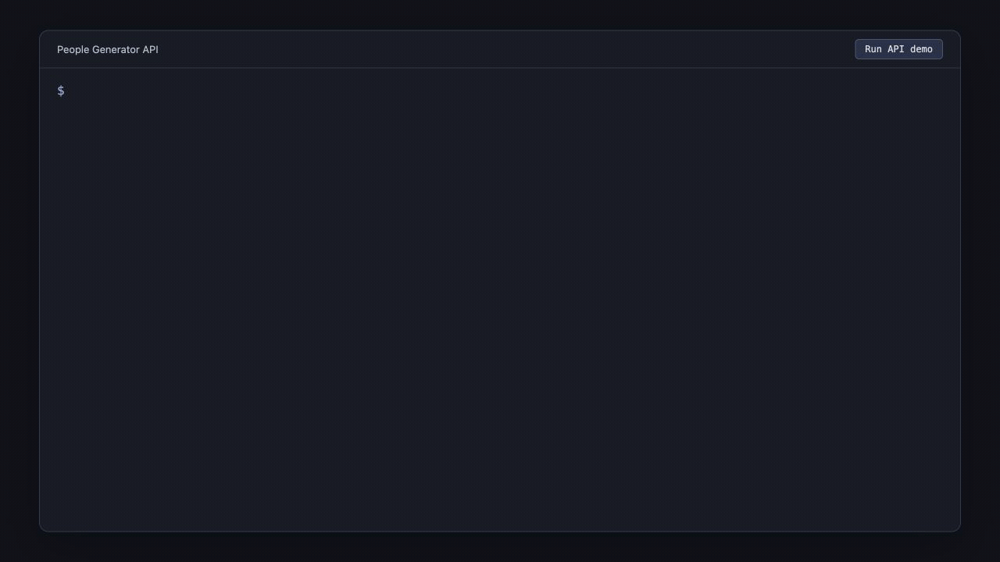
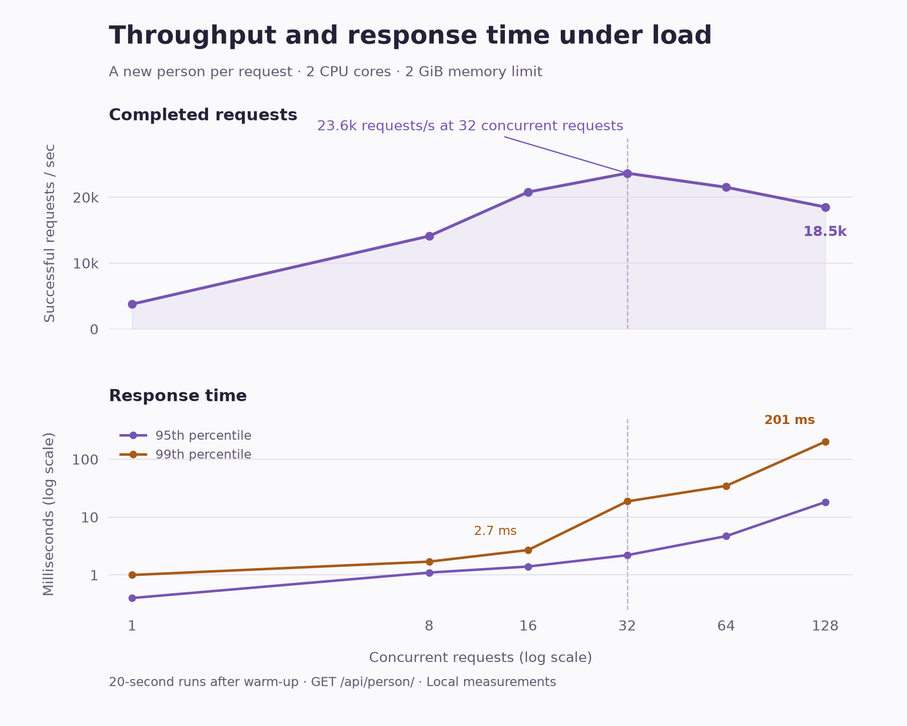

# People Generator API

People Generator API creates random people for testing. You can generate a complete profile with a name, job, address, and contact details, or request just the fields you need. It also supports batches of up to 50,000 people.

I built it in Java with Spring Boot. The website has a demo where you can generate a person and inspect the response, along with examples for using the API in your own code. You can run everything locally without an API key or a database.



## Getting started

You'll need JDK 22 to run the project. Clone the repository and start the application with the included Maven wrapper.

```sh
git clone https://github.com/ltmerletti/peoplegenerator-api.git
cd peoplegenerator-api
bash mvnw spring-boot:run
```

Once the server starts, open [localhost:8080](http://localhost:8080) to try the website. The application loads its sample data and warms up before starting, so give it a moment on the first run.

## Using the API

You can request a person directly from the server.

```sh
curl http://localhost:8080/api/person/
```

Each request generates a new person. The response includes their address and about twenty other fields, from their age and occupation to their height and blood type. Here are a few of the fields from an example response.

```json
{
  "name": "Carlton Wilkinson",
  "age": 51,
  "job": "Dental Hygienist",
  "email": "wilkinson.wilkinson@hotmail.com",
  "address": {
    "streetAddress": "25396 Delmar Circle",
    "city": "Tbilisi",
    "country": "Georgia"
  }
}
```

If you need several people, add the number to the URL. Batch responses are compressed, so include `--compressed` when using curl.

```sh
curl --compressed http://localhost:8080/api/person/10
```

Wait at least 10 seconds after your last API request before asking for a batch. The server returns HTTP 429 if you make a request too soon.

You can also request an address, a short life story, or a single field such as a name.

| Endpoint | What you get |
| --- | --- |
| `/api/person/` | A complete person, including their address |
| `/api/person/{count}` | A batch of 1 to 50,000 people |
| `/api/address/` | An address with contact details |
| `/api/lifestory/` | A person and a short description of their life |
| `/api/person/name/` | A generated name |
| `/api/person/email/` | A generated email address |

The [API reference](docs/api.md) lists every endpoint and response field. The website also has code examples in JavaScript, Python, and Java under `/get-started`, and you can try requests through the OpenAPI explorer at `/swagger-ui/index.html`.

## How the data is generated

The generator combines bundled lists of names, jobs, salaries, and cities with values from JavaFaker. Some fields depend on the person's age, so a child gets a student job title and a person over 69 gets a retired one. The life story is assembled from the same profile using a text template.

The records are meant for sample data. The generator doesn't keep every detail consistent, so an address may pair a city with a different region, and a birth date may not line up exactly with the person's age. Generated contact details can also overlap with real ones.

## Performance

In a local test with two CPU cores and a 2 GiB container memory limit, the API generated about **19,300 people per second for a full minute**. All **1.16 million requests** succeeded, and 95% completed within **2.9 ms**. The load generator ran separately on the same Mac and simulated many clients, each requesting a complete person.

The shorter runs below show how throughput and response time change as concurrency increases. Throughput peaked at 32 concurrent requests; adding more requests increased response times while completing fewer profiles per second.



The bulk endpoint also limits generation to four batches at once. When tested with 32 simultaneous requests for 50,000 people each, four completed and the others received a retry response. The application stayed running and handled the next request successfully.

The [test setup and results](docs/benchmarks/README.md) include the hardware, resource limits, timings, and scripts for repeating the test.

## Working on the project

The Java source is in `src/main/java`, and the website's HTML, CSS, and JavaScript are in `src/main/resources/templates` and `src/main/resources/static`. The CSV files used by the generator are bundled under `src/main/resources/org`.

To run the tests and build a fresh JAR, use the Maven wrapper.

```sh
bash mvnw clean package
java -jar target/peoplegeneratorapi-1.2.0.jar
```

Build from source when trying the current version. The JARs already checked into the repository are older builds.

If you find a bug or have an idea, [open an issue](https://github.com/ltmerletti/peoplegenerator-api/issues). Pull requests are welcome too.

## License

This project is licensed under the [GNU General Public License v2.0](LICENSE).
